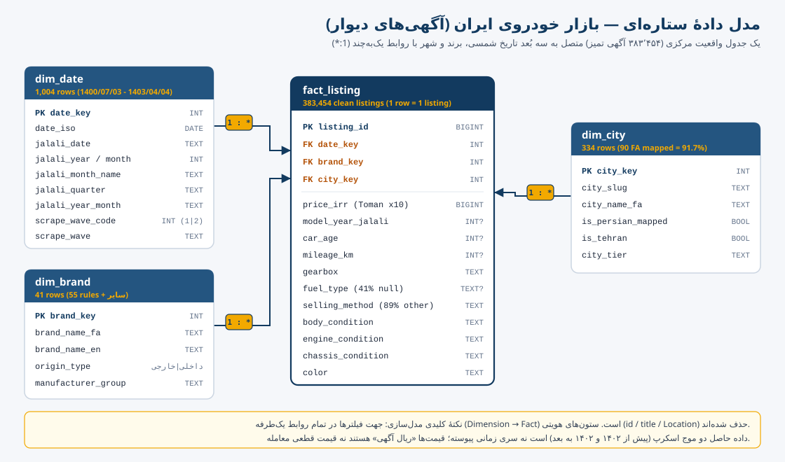

# Analytics of 383k Divar Listings — Iran Used-Car Market Power BI Case Study

> **Disclaimer:** "Iran Car Market" is a descriptive portfolio project title with no affiliation to any real company, dealership, or marketplace. All figures reflect publicly scraped classified listings (asking prices in IRR, not settled transactions).

## 1. Business Context & Project Objective

Iran's secondary automotive market is highly fragmented across local platforms, combining domestic platforms (IKCO, Saipa) with imported and semi-knocked-down (SKD) Asian and European models. Raw classified listings suffer from noisy Persian/Arabic digits, reversed BiDi strings in legacy scrapes, placeholder prices (`0`, `111,111,111`), unstructured composite brand titles, mixed Jalali/Gregorian model years, and inconsistent city slugs.

This portfolio project demonstrates an **end-to-end Persian RTL Business Intelligence solution** built on real-world Iranian classifieds data (`arianghasemi/divar-cars`, Kaggle v5, `406,923` raw records) — designed for **Microsoft Power BI Desktop** and accompanied by an offline-capable 5-page **Streamlit preview application**.

---

## 2. Architecture & Deterministic ETL Pipeline

The entire data product is deterministically rebuilt from the untouched raw CSV (`data/raw/final2024.csv`, ~95 MB) via `scripts/build_data.py` with **zero randomness (no synthetic data, no seed)**:

1. **Price Sanitization & IRR Normalization:**
   - Dropped `23,469` rows (`5.77%`): null prices (`13,096`), zero/negative (`8,658`), and implausible values below 10M Toman (`1,715`), retaining **`383,454` clean listings**.
   - Converted asking prices from Toman to Iranian Rial (`price_irr = Toman × 10`). No FX conversion or inflation adjustment is applied.
2. **Calendar & Model-Year Standardization:**
   - Normalized Persian/Arabic numerals to ASCII across `Price`, `Mileage`, and `Model_Year`.
   - Converted Gregorian model years (`≥ 1800`) to exact Jalali (`year - 621`), mapped `"قبل از ۱۳۶۶"` to `NaN`, and computed `car_age` at listing time (`median = 8 years`, range `0–37`).
   - Built a contiguous 1,004-day Jalali/Gregorian `dim_date` spanning `2021-09-25` to `2024-06-24` (`1400/07/03` to `1403/04/04`).
3. **Rule-Based Brand Extraction (55 Boundary-Safe Rules → 41 Brands):**
   - Parsed composite and BiDi-reversed Persian strings (e.g., `"پراید صندوق‌دار بنزینی"` and `"SE ،131 ،پراید"`) using boundary-safe regex rules to prevent substring collisions (such as `"تارا"` matching `"ویتارا"` or `"بنز"` matching `"بنزینی"`).
   - Enriched `dim_brand` with `origin_type` (`داخلی` vs `خارجی` vs `نامشخص`) and `manufacturer_group`.
4. **Transparent City Normalization (334 Cities):**
   - Mapped the top 90 cities to official Persian names (`91.71%` of all listings) while intentionally preserving cleaned Latin slugs for the remaining 244 smaller towns to avoid speculative transliteration.
5. **Privacy & Hygiene:**
   - Stripped all identity/free-text columns (`id`, `title`, `Location`) and ultra-sparse/redundant columns (`Third_party_insurance`, `Front_Chassis`, `Rear_Chassis`).

---

## 3. Star Schema & Power BI Assets

- **Central Fact:** `fact_listing` (`383,454` rows, `listing_id` PK, FKs to `date_key`, `brand_key`, `city_key`).
- **Dimensions:** `dim_date` (`1,004` rows), `dim_brand` (`41` rows), `dim_city` (`334` rows) with unidirectional `1:*` relationships.
- **DAX Layer (`model/measures.dax`):** 27 standardized measures across Volume/Share, Median/Quantile Asking Prices, Technical Mix, Unadjusted Wave Comparison, and Data Quality Diagnostics.
- **Theme (`report/theme.json`):** Custom **"Iran Car Market Fa"** JSON theme (`#123a5f` navy, `#f2a900` gold accent, `#f5f7fa` canvas, `Vazirmatn FD`).
- **Build Guide (`report/POWER_BI_BUILD_GUIDE.md`):** Step-by-step Desktop assembly instructions (deliberately omitting a binary `.pbix` for full Git auditability).

---

## 4. Key Analytical Findings

| Metric | Value | Notes |
|---|---:|---|
| Clean Listings | **383,454** | Across 334 cities and 41 brand buckets |
| Median Asking Price | **3.30B IRR** | Mean = 5.98B IRR (right-skewed; median preferred) |
| Median Mileage / Car Age | **110,000 km** / **8 yrs** | Noticeable heaping at round numbers & `111,111` |
| Tehran Concentration | **27.38%** | Top 5 cities account for 52.7% of all listings |
| Manual Gearbox Share | **70.22%** | Automatic = 13.79%, Unknown = 15.99% |
| Domestic vs Foreign Brands | **73.36%** vs **19.17%** | Peugeot (28.1%) & Pride (18.1%) dominate supply |

### Two Scrape Waves — Analytical Honesty Over False Trends

A critical audit finding is that listings are concentrated in **two discrete scraping windows**, NOT a continuous time series:
- **Wave 1 (Pre-1402 / before `2023-03-21`):** `43,330` listings (`11.3%`), median asking price **`1.91B IRR`**.
- **Wave 2 (1402+ / from `2023-03-21`):** `340,124` listings (`88.7%`), median asking price **`3.54B IRR`**.

Accordingly, the report **explicitly refuses to plot price trend lines or claim market appreciation**, presenting Wave 1 vs Wave 2 solely as an **unadjusted descriptive comparison**.

---

## 5. Verification & Quality Assurance

- **15 Automated Data Quality Tests (`tests/test_data_quality.py`):** Row counts, PK uniqueness, 100% FK integrity, positive IRR multiples of 10, Jalali year/age/mileage bounds, gearbox/selling-method domains, contiguous `dim_date`, `summary_stats.json` reconciliation, and PII exclusion — **15/15 passing**.
- **Streamlit `AppTest` + Playwright Audit:** All 5 pages verified programmatically with interactive filter checks, zero console errors, and **zero external network requests** (local embedded `Vazirmatn FD` webfont).
- **Explicitly Untested:** DAX execution inside Power BI's VertiPaq engine, theme JSON rendering inside Power BI Desktop, and manual inspection of every raw brand string.
