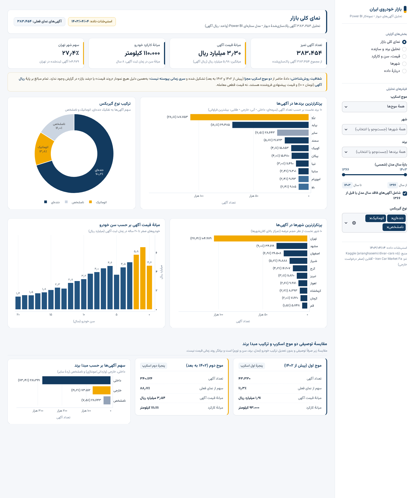

# بازار خودروی ایران — تحلیل ۳۸۳ هزار آگهی دیوار (نمونه‌کار Power BI فارسی)



> **شفافیت و عدم وابستگی:** نام «بازار خودروی ایران» صرفاً توصیفی است و هیچ وابستگی به هیچ شرکت، نمایشگاه یا نهاد واقعی ندارد. این پروژه یک **نمونه‌کار تحلیل داده و هوش تجاری (Power BI)** بر پایهٔ دادهٔ عمومی واقعی آگهی‌های دیوار است. فایل باینری `.pbix` عمداً تولید نشده تا تمام لایه‌ها (ETL، مدل ستاره‌ای، DAX، تم و راهنمای ساخت) متن‌باز و قابل بازبینی باشند.

---

## ۱. خلاصهٔ اجرایی پروژه

این پروژه دادهٔ واقعی آگهی‌های خودروی دست‌دوم ایران (`arianghasemi/divar-cars` نسخهٔ **v5** در Kaggle، با `۴۰۶٬۹۲۳` آگهی خام) را از طریق یک پایپ‌لاین قطعی و بدون تصادف (`scripts/build_data.py`) پاک‌سازی کرده و به یک **مدل ستاره‌ای استاندارد Power BI** تبدیل می‌کند:

| شاخص کلیدی | مقدار واقعی |
|---|---:|
| آگهی‌های خام ورودی (`data/raw/final2024.csv`) | ۴۰۶٬۹۲۳ آگهی (۱۹ ستون) |
| آگهی‌های تمیز نهایی (`fact_listing.csv`) | **۳۸۳٬۴۵۴ آگهی** (حذف ۵٫۷۷٪ در فیلتر قیمت) |
| بازهٔ اسنپ‌شات داده (شمسی / میلادی) | `۱۴۰۰/۰۷/۰۳` تا `۱۴۰۳/۰۴/۰۴` (`2021-09-25` تا `2024-06-24`) |
| میانهٔ قیمت آگهی (واحد: ریال آگهی = تومان × ۱۰) | **۳٫۳۰ میلیارد ریال** (میانگین: ۵٫۹۸ میلیارد ریال) |
| میانهٔ کارکرد / میانهٔ سن خودرو | **۱۱۰٬۰۰۰ کیلومتر** / **۸ سال** |
| سهم شهر تهران از کل آگهی‌ها | **۲۷٫۳۸٪** (`۱۰۴٬۹۷۹` آگهی) |
| سهم گیربکس دنده‌ای | **۷۰٫۲۲٪** (`۲۶۹٬۲۶۶` آگهی) |
| ابعاد مدل ستاره‌ای | `dim_brand` (**۴۱** برند) • `dim_city` (**۳۳۴** شهر) • `dim_date` (**۱٬۰۰۴** روز پیوسته) |

### مقایسهٔ توصیفی دو موج اسکرپ (سری زمانی نیست!)

آگهی‌ها در دو پنجرهٔ برداشت مجزا متمرکزند و **یک سری زمانی پیوسته تشکیل نمی‌دهند**:
- **موج اول (پیش از ۱۴۰۲):** `۴۳٬۳۳۰` آگهی (`۱۱٫۳۰٪`) با میانهٔ قیمت آگهی `۱٫۹۱ میلیارد ریال`.
- **موج دوم (۱۴۰۲ به بعد):** `۳۴۰٬۱۲۴` آگهی (`۸۸٫۷۰٪`) با میانهٔ قیمت آگهی `۳٫۵۴ میلیارد ریال`.

> هیچ نمودار «روند قیمت» یا ادعای «رشد بازار» در این پروژه وجود ندارد؛ مقایسهٔ بالا صرفاً توصیفی و **بدون تعدیل ترکیب خودرو** و بدون لحاظ‌کردن تورم است.

---

## ۲. ساختار پوشه‌ها و تحویل‌ها

```text
project_02_iran_car_market/
├── app.py                           # اپ پیش‌نمایش Streamlit (۵ صفحه، RTL، Vazirmatn FD، پورت 8503)
├── README_FA.md                     # معرفی فارسی پروژه (همین فایل)
├── PORTFOLIO_CASE_STUDY_EN.md       # مطالعهٔ موردی انگلیسی نمونه‌کار (Analytics of 383k Divar Listings)
├── VALIDATION.md                    # گزارش ۱۵ تست کیفیت داده + AppTest + موارد تست‌نشده
├── LIMITATIONS.md                   # محدودیت‌های تحلیلی و قواعد صداقت داده
├── SOURCES.md                       # شناسنامهٔ منبع Kaggle، مجوز و تبدیل‌ها
├── scripts/
│   └── build_data.py                # پایپ‌لاین ETL قطعی و قابل بازتولید از دادهٔ خام (بدون seed)
├── data/
│   ├── raw/
│   │   ├── final2024.csv            # دادهٔ خام بدون تغییر (~۹۵ مگابایت)
│   │   └── README.md                # راهنمای دانلود مجدد از Kaggle
│   ├── processed/
│   │   ├── fact_listing.csv         # جدول واقعیت (۳۸۳٬۴۵۴ سطر)
│   │   ├── dim_brand.csv            # بُعد برند (۴۱ ردیف، ۵۵ قاعدهٔ مرزبندی‌شده)
│   │   ├── dim_city.csv             # بُعد شهر (۳۳۴ ردیف: ۹۰ فارسی + ۲۴۴ لاتین منبع)
│   │   ├── dim_date.csv             # تقویم پیوستهٔ شمسی (۱٬۰۰۴ روز تا ۱۴۰۳/۰۴/۰۴)
│   │   └── summary_stats.json       # خلاصهٔ آماری و کنترلی
│   ├── DATA_DICTIONARY.md           # فرهنگ دادهٔ کامل جداول
│   └── DATA_QUALITY_REPORT.md       # گزارش عددی کیفیت داده و قیف پاک‌سازی
├── model/
│   ├── MODEL.md                     # مستندات معماری مدل ستاره‌ای
│   └── measures.dax                 # سنجه‌های استاندارد DAX (۵ گروه)
├── report/
│   ├── POWER_BI_BUILD_GUIDE.md      # راهنمای گام‌به‌گام ساخت گزارش در Power BI Desktop
│   └── theme.json                   # تم رسمی «Iran Car Market Fa» (#123a5f / #f2a900 / #f5f7fa)
├── tests/
│   └── test_data_quality.py         # مجموعهٔ ۱۵ تست خودکار کیفیت و تمامیت مدل
└── assets/
    ├── preview.png                  # اسکرین‌شات واقعی اپ پیش‌نمایش (Playwright 1540×1850)
    ├── model_diagram.svg            # نمودار وکتور مدل ستاره‌ای
    └── fonts/                       # فونت‌های محلی Vazirmatn FD (صفر درخواست شبکهٔ خارجی)
```

---

## ۳. اجرای سریع (بازتولید داده، تست و اپ پیش‌نمایش)

```bash
cd project_02_iran_car_market

# ۱) بازتولید کامل جداول ستاره‌ای از فایل خام
python3 scripts/build_data.py

# ۲) اجرای ۱۵ تست خودکار کیفیت داده و تمامیت کلیدهای خارجی
python3 -m unittest discover -s tests -v

# ۳) اجرای اپ پیش‌نمایش تعاملی (پورت 8503)
streamlit run app.py --server.port 8503 --server.address 0.0.0.0
```

برای ساخت گزارش نهایی در **Power BI Desktop**، فایل `report/POWER_BI_BUILD_GUIDE.md` را دنبال کنید.

---

## ۴. پیوند به اسناد تکمیلی

- معماری مدل و سنجه‌ها: `model/MODEL.md` و `model/measures.dax`
- فرهنگ داده و گزارش کیفیت: `data/DATA_DICTIONARY.md` و `data/DATA_QUALITY_REPORT.md`
- اعتبارسنجی و موارد تست‌نشده: `VALIDATION.md`
- محدودیت‌های کلیدی: `LIMITATIONS.md`
- منابع و مجوز: `SOURCES.md`
- مطالعهٔ موردی انگلیسی برای رزومه/لینکدین: `PORTFOLIO_CASE_STUDY_EN.md`
